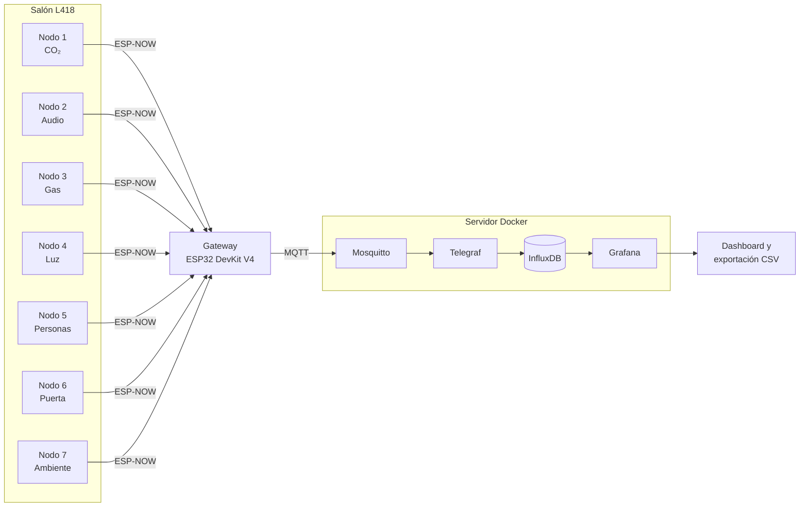

# Gemelo Digital del Salón L418 — Arquitectura IoT

Sistema de monitoreo en tiempo real del salón L418 de la Universidad de Ingeniería y
Tecnología (UTEC). Siete nodos ESP32 miden la calidad del aire, el ruido, la iluminación,
el ambiente térmico, la ocupación y el estado de la puerta. Los datos se almacenan como
series de tiempo y se visualizan en un dashboard que permite exportar a CSV cualquier
rango de tiempo. Esta infraestructura de datos alimenta el gemelo digital del salón.

**Curso:** PI3103 – Proyectos Interdisciplinarios 3 · **Profesor:** Jorge Fernando Figueroa Nuñez Del Prado· **Semestre:** 2026-2

---

## Arquitectura



1. **Nodos sensores:** cada ESP32 DevKit V1 lee su sensor, calcula indicadores y detecta
   anomalías en el propio nodo. Envía paquetes binarios por **ESP-NOW**, que no necesita red WiFi.
2. **Gateway (ESP32 DevKit V4):** único dispositivo conectado al WiFi. Asigna la hora real
   (NTP), convierte cada paquete a JSON y lo publica por **MQTT** en
   `utec/gemelo/<grupo>/nodo<id>/<tipo>`.
3. **Servidor:** Mosquitto (broker MQTT) → Telegraf (ingesta) → InfluxDB (series de tiempo)
   → Grafana (dashboard), todo en contenedores Docker.

## Nodos y sensores

| Nodo | Sensor | Variable | Tabla en InfluxDB | Ubicación |
|:---:|---|---|---|---|
| 1 | MH-Z1911A | CO₂ | `co2` | Techo, centro |
| 2 | INMP441 | Nivel sonoro | `audio` | Techo, centro |
| 3 | MQ-2 | Gas / humo | `gas` | Techo, separado de los demás |
| 4 | GY-302 BH1750 | Iluminación | `luz` | Techo, centro |
| 5 | MLX90640 | Conteo de personas | `termico` | Marco de la puerta (2.3 m) |
| 6 | KY-024 | Estado de la puerta | `magnetico` | Marco de la puerta |
| 7 | GY-BME280 | Temperatura, humedad, presión | `ambiente` | Techo, centro |

## Estructura del repositorio

```
Gemelo_IoT/
├── firmware/                  Código de los ESP32 (Arduino IDE)
│   ├── paquetes.h             Contrato de datos común (copia de referencia)
│   ├── gateway/               Gateway ESP32 v4 — versión servidor local
│   ├── gateway_nube/          Gateway con MQTT cifrado (TLS) — versión nube, en pausa
│   ├── obtener_mac/           Utilidad para leer la MAC del gateway
│   ├── nodo_co2/              Nodo 1 — MH-Z1911A
│   ├── nodo_audio/            Nodo 2 — INMP441
│   ├── nodo_gas/              Nodo 3 — MQ-2
│   ├── nodo_luz/              Nodo 4 — BH1750
│   ├── nodo_termico/          Nodo 5 — MLX90640
│   ├── nodo_magnetico/        Nodo 6 — KY-024
│   └── nodo_ambiente/         Nodo 7 — BME280
├── servidor/
│   ├── servidor_iot/          Servidor local (laptop): Mosquitto, Telegraf, InfluxDB, Grafana
│   └── servidor_iot_prod/     Servidor en la nube: + Caddy (HTTPS), MQTT con TLS — en pausa
├── grafana/                   Dashboards para importar en Grafana
└── docs/                      Informe técnico y documentación
```

**¿Por qué `paquetes.h` aparece en varias carpetas?** Arduino IDE solo compila los archivos
que están en la carpeta del sketch. Por eso cada nodo y el gateway llevan su propia copia.
**Todas las copias deben ser idénticas**: si se modifica, hay que reemplazarla en todas las
carpetas y volver a programar los ESP32 afectados (siempre el gateway).

## Puesta en marcha (servidor local)

### 1. Servidor
Requisitos: [Docker Desktop](https://www.docker.com/products/docker-desktop/) con WSL 2.

```bash
cd servidor/servidor_iot
cp .env.example .env        # en Windows: copy .env.example .env
# Editar .env con contraseñas propias
docker compose up -d
```

| Servicio | Dirección |
|---|---|
| Grafana | http://localhost:3000 |
| InfluxDB | http://localhost:8086 |
| MQTT | puerto 1883 |

Importar el dashboard: Grafana → *Dashboards → New → Import* → archivo de la carpeta `grafana/`.

### 2. Firmware
Requisitos: Arduino IDE con el núcleo ESP32 y estas librerías del Gestor de Librerías:
*PubSubClient* (gateway), *Adafruit MLX90640*, *Adafruit BME280*, *BH1750* (Christopher Laws).

1. Cargar `firmware/obtener_mac/` en el gateway y anotar su MAC.
2. Completar los valores marcados en cada `.ino` (tabla siguiente).
3. Programar primero el gateway y luego los nodos.

| Archivo | Qué completar |
|---|---|
| `gateway/gateway.ino` | `WIFI_SSID`, `WIFI_PASS`, `GRUPO`, `MQTT_HOST` (IPv4 del servidor) |
| `nodo_*/nodo_*.ino` | `MAC_GATEWAY`, `SSID_ROUTER` (mismo nombre de red que el gateway) |
| `nodo_audio.ino` | `OFFSET_SPL_DB` (calibración con sonómetro) |
| `nodo_gas.ino` | `R_L`, `V_C`; calibrar R0 con el comando `CAL` tras 24 h de precalentamiento |
| `nodo_luz.ino` | `FACTOR_MESA` (relación entre la luz en la mesa y en el techo) |
| `nodo_termico.ino` | `SENTIDO_ENTRADA` (verificar con `DEBUG_MAPA 1`) |
| `nodo_magnetico.ino` | `UMBRAL_CERRADA`, `UMBRAL_ABIERTA` (verificar con `DEBUG_RAW 1`) |

> La red WiFi debe ser de **2.4 GHz**: el ESP32 no se conecta a redes de 5 GHz.

### 3. Verificación
```bash
docker exec -it mosquitto mosquitto_sub -t "utec/gemelo/#" -v
```
Deben aparecer los mensajes JSON de cada nodo. En InfluxDB (*Data Explorer*, bucket
`gemelo`) aparece una tabla por tipo de sensor.

## Formato de los datos

Cada mensaje MQTT es un JSON con una cabecera común y los campos propios del sensor:

```json
{"nodo":1,"mac":"00:70:07:A1:E0:24","seq":1409,"ts":1793552417884,"uptime_ms":7050021,
 "perdidos":0,"tipo":"co2","co2_ppm":571,"delta_30s":0,"temp_c":32,"calentando":0,
 "nivel":"NORMAL","anomalias":"NINGUNA","anom_bits":0}
```

- `ts`: hora UTC en milisegundos, asignada por el gateway.
- `seq` y `perdidos`: contador de paquetes y paquetes perdidos por nodo.
- `anomalias`: anomalías activas separadas por `|`, o `NINGUNA`.

La definición binaria de cada paquete está en `firmware/paquetes.h`.

## Seguridad

Este repositorio **no contiene contraseñas, tokens ni certificados**. Los archivos `.env`
están excluidos por `.gitignore`; se incluyen `.env.example` con valores de ejemplo.
En los `.ino`, las credenciales aparecen como marcadores que se completan localmente
y **no deben subirse con valores reales**.

## Estado del proyecto

- [x] Siete nodos programados y validados en simulación
- [x] Arquitectura validada de punta a punta con servidor local
- [x] Dashboard con exportación CSV
- [x] Versión de producción preparada (HTTPS, MQTT con TLS, acceso público de solo lectura)
- [ ] Despliegue en la nube (pendiente de autorización de TI)
- [ ] Calibración del micrófono y de R0 del MQ-2 en el salón
- [ ] Integración con el gemelo digital 2D ([repositorio Web-PI3](https://github.com/MaintzTachyon/Web-PI3))

## Equipo

| Integrante | Responsabilidad |
|---|---|
| Abel Romulo Chuquillanqui Maraví | Integración de hardware (soldadura y conexionado de sensores) y arquitectura IoT: nodos de CO₂ y ruido, comunicación ESP-NOW/MQTT, gateway, servidor y dashboard |
| Sebastian Falvy Mendoza | Gemelo digital 2D ([Web-PI3](https://github.com/MaintzTachyon/Web-PI3)) |
| Juan Diego Mejía Armasa | Gemelo digital 2D ([Web-PI3](https://github.com/MaintzTachyon/Web-PI3)) |
| Deyver Ricardo Fuertes Palpa | Diseño de carcasas de los módulos y gestión del proyecto (Asana) |

## Documentación

- `docs/informe_gemelo_digital.tex`: informe técnico de implementación y migración (compilar en Overleaf).
- Gemelo digital 2D: [github.com/MaintzTachyon/Web-PI3](https://github.com/MaintzTachyon/Web-PI3)

## Referencias (hojas de datos)

Adafruit. (s. f.). *Adafruit MLX90640 IR Thermal Camera Breakout - 55 Degree: Datasheet* [Product ID: 4407]. Adafruit Industries. Recuperado el 10 de noviembre de 2026, de https://www.adafruit.com/product/4407

AG Electrónica. (2019). *Sensor de presión atmosférica GY-BME280* (No. Parte: OKY3259-2). AG Electrónica S.A.P.I. de C.V. Recuperado el 10 de noviembre de 2026, de https://agelectronica.com/detalle?busca=OKY3259-2

Handson Technology. (s. f.). *BH1750 Ambient Light Sensor Module: Data Specs* (SKU: SSR1054). Handson Technology. Recuperado el 10 de noviembre de 2026, de https://handsontec.com/index.php/product/bh1750-ambient-light-sensor-module/

Joy-IT. (2021). *KY-024 Linear magnetic Hall Sensor: Manual* (SensorKit X40). Joy-IT / Simac Electronics B.V. Recuperado el 10 de noviembre de 2026, de https://joy-it.net/en/products/SEN-KY024LM

Naylamp Mechatronics. (s. f.). *Micrófono I2S INMP441*. Naylamp Mechatronics. Recuperado el 10 de noviembre de 2026, de https://naylampmechatronics.com/audio-sonido/1037-microfono-i2s-inmp441.html

Technologies Private Limited. (s. f.). *ADIY MQ-2 Smoke Sensor Module: Datasheet*. ADIY. Recuperado el 10 de noviembre de 2026, de https://adiy.in/shop/mq2-smoke-sensor-module/

Zhengzhou Winsen Electronics Technology Co., Ltd. (2023). *Infrared CO2 Sensor (Model: MH-Z1911A): User's Manual* (Version 1.1). Winsen. Recuperado el 10 de noviembre de 2026, de https://www.winsen-sensor.com/product/mh-z1911a.html?searchid=5618
